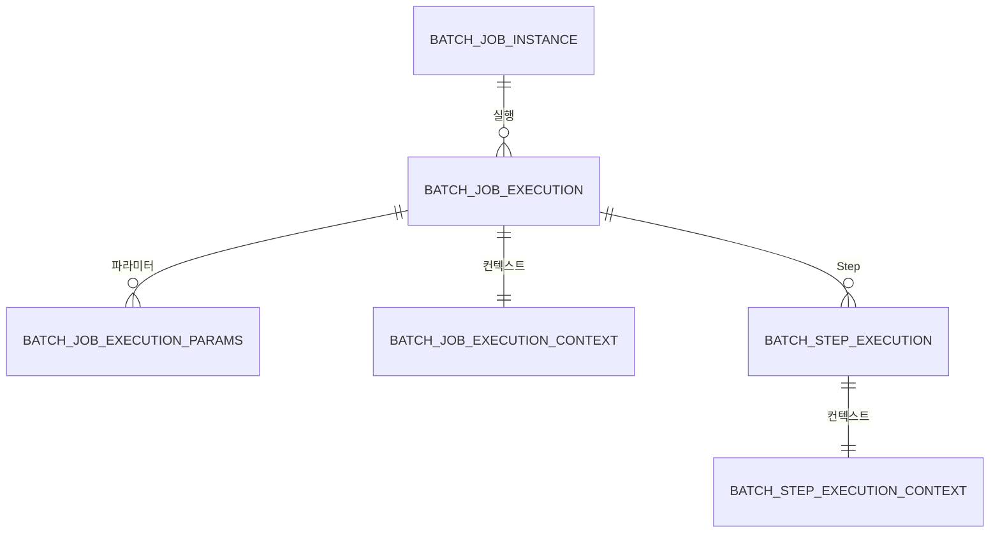

# Faith Pathway (Holylife) ERD

> **기준**: 실제 운영 DB 스키마 (`holylife`, MariaDB 10.11) · 2026-11-11 조회
> **구성**: 비즈니스 테이블 **22개** + Spring Batch 메타 테이블 **6개** + 시퀀스 **3개**
> 이 문서는 DB `information_schema`에서 자동 추출한 결과를 기반으로 작성되었습니다.

---

## 1. ERD 다이어그램

```mermaid
erDiagram
    USERS ||--o{ USER_ROLES : "역할 할당"
    ROLES ||--o{ USER_ROLES : "역할"
    MENUS ||--o{ MENUS : "하위 메뉴"
    ROLES ||--o{ PERMISSIONS : "권한"
    MENUS ||--o{ PERMISSIONS : "대상 메뉴"
    GROUP_CODES ||--o{ COMMON_CODES : "소속 그룹"
    USERS ||--o{ SERMONS : "작성"
    SERMONS ||--o{ SERMON_TAGS : "태그"
    TAGS ||--o{ SERMON_TAGS : "태그"
    USERS ||--o{ QTS : "작성"
    TAGS ||--o{ QT_TAGS : "태그"
    QTS ||--o{ QT_TAGS : "태그"
    USERS ||--o{ READING_NOTES : "작성"
    PBS_FOLDER ||--o{ PBS_FOLDER : "하위 폴더"
    PBS_FOLDER ||--o{ PBS_PAGE : "소속"
    USERS ||--o{ PBS_PAGE : "작성"
    PBS_PAGE ||--o{ PBS_PAGE_SECTION : "영역"
    PBS_PAGE ||--o{ PBS_REFERENCE : "참고자료"
    PBS_PAGE ||--o{ PBS_TAG_MAP : "태그 연결"
    TAGS ||--o{ PBS_TAG_MAP : "태그"
    BIBLE_VERSIONS ||--o{ BIBLE_BOOKS : "역본"

    USERS {
        bigint user_id PK "사용자 ID"
        varchar email "이메일 주소 (로그인 ID)"
        varchar password "비밀번호 (BCrypt 암호화)"
        varchar name "이름"
        varchar nickname "닉네임"
        varchar phone "전화번호"
        varchar role_group "권한 그룹 코드"
        varchar account_status "계정 상태 (ACTIVE/INACTIVE/PENDING)"
        varchar bible_version "선호 성경 버전"
        varchar qt_source "QT 출처"
        varchar memo "메모"
        boolean email_notification "이메일 알림 수신 여부"
        boolean two_factor_auth "2단계 인증 사용 여부"
        boolean session_auto_expiry "세션 자동 만료 여부"
        boolean activity_log "활동 로그 기록 여부"
        datetime last_login "최종 로그인 일시"
    }
    ROLES {
        bigint role_id PK "권한 ID"
        varchar group_code "그룹 코드"
        varchar group_name "그룹명"
        varchar group_desc "그룹 설명"
        boolean use_yn "사용 여부"
    }
    USER_ROLES {
        bigint user_role_id PK "매핑 ID"
        bigint user_id FK "사용자 ID"
        bigint role_id FK "권한 ID"
    }
    MENUS {
        bigint menu_id PK "메뉴 ID"
        bigint parent_id FK "상위 메뉴 ID (self-reference, NULL=1Depth)"
        varchar parent_name "상위 메뉴명 (표시용)"
        varchar menu_name "메뉴명"
        varchar menu_code "메뉴 코드"
        varchar menu_url "메뉴 URL"
        int depth "메뉴 깊이 (1=1Depth, 2=2Depth)"
        int sort_order "정렬 순서"
        varchar icon "메뉴 아이콘"
        boolean use_yn "사용 여부"
        boolean display_yn "노출 여부"
    }
    PERMISSIONS {
        bigint permission_id PK "권한 매핑 ID"
        bigint role_id FK "권한 그룹 ID"
        bigint menu_id FK "메뉴 ID"
        boolean can_read "읽기 권한"
        boolean can_write "쓰기 권한"
        boolean can_delete "삭제 권한"
    }
    GROUP_CODES {
        varchar group_code PK "그룹 코드"
        varchar group_name "그룹 코드명"
        datetime modified_date "최종 수정일시"
    }
    COMMON_CODES {
        bigint code_id PK "코드 ID"
        varchar group_code FK "그룹 코드"
        varchar code "코드값"
        varchar code_name "코드명"
        int sort_order "정렬 순서"
        boolean use_yn "사용 여부"
        datetime modified_date "최종 수정일시"
    }
    SERMONS {
        bigint sermon_id PK "설교 ID"
        bigint user_id FK "작성자 ID"
        varchar title "설교 제목"
        date sermon_date "설교 날짜"
        varchar preacher "설교자"
        varchar bible_ref "성경 구절 참조"
        text bible_text "성경 본문"
        text content "설교 내용"
        varchar status "상태 (DRAFT/PUBLISHED)"
    }
    SERMON_TAGS {
        bigint sermon_tag_id PK "매핑 ID"
        bigint sermon_id FK "설교 ID"
        bigint tag_id FK "태그 ID"
    }
    QTS {
        bigint qt_id PK "QT ID"
        bigint user_id FK "작성자 ID"
        varchar title "QT 제목"
        date qt_date "QT 날짜"
        varchar bible_ref "성경 구절 참조"
        text bible_text "성경 본문"
        text content "QT 내용 (묵상/적용)"
        varchar visibility "공개 범위 (PUBLIC/PRIVATE)"
    }
    QT_TAGS {
        bigint qt_tag_id PK "매핑 ID"
        bigint qt_id FK "QT ID"
        bigint tag_id FK "태그 ID"
    }
    QT_DAILY {
        bigint qt_id PK "QT ID"
        date qt_date "QT 날짜"
        varchar bible_ref "성경 구절 참조"
        varchar title "QT 제목"
        varchar hymn_info "찬송가 정보"
        text hymn_text "찬송가 가사"
        varchar bible_section_title "성경 구절 제목"
        text bible_text "성경 본문"
        text prayer "기도문"
        varchar source "출처"
    }
    READING_NOTES {
        bigint reading_id PK "독서 노트 ID"
        bigint user_id FK "작성자 ID"
        varchar book_title "도서 제목"
        date read_date "독서 날짜"
        varchar author "저자"
        varchar translator "번역자"
        text toc "목차"
        varchar cover_image "책 표지 이미지 경로"
        text summary "요약"
        text impression "감상/소감"
    }
    TAGS {
        bigint tag_id PK "태그 ID"
        varchar tag_name "태그명"
    }
    REFERENCE_RESOURCES {
        bigint ref_id PK "참고자료 ID"
        varchar ref_type "참조 대상 타입 (SERMON/QT/PBS/READING)"
        bigint target_id "참조 대상 ID"
        varchar ref_category "자료 카테고리 (URL/FILE)"
        varchar url "URL"
        varchar file_path "파일 경로"
        varchar file_name "파일명"
        varchar file_type "파일 타입"
        varchar file_size "파일 크기"
        text description "설명"
        int sort_order "정렬 순서"
    }
    PBS_FOLDER {
        bigint folder_id PK "폴더 ID"
        bigint parent_id FK "부모 폴더 ID (FK, NULL=루트)"
        varchar folder_name "폴더명 (예: 창세기, 출애굽기)"
        int sort_order "정렬 순서"
    }
    PBS_PAGE {
        bigint page_id PK "페이지 ID"
        bigint folder_id FK "폴더 ID"
        bigint user_id FK "작성자 ID"
        varchar title "페이지 제목 (생성시 임시 제목)"
        text content "페이지 내용 (자동 저장)"
        varchar status "상태 (DRAFT=임시저장, PUBLISHED=배포됨)"
        varchar testament "신구약 (OLD/NEW)"
        varchar book_code "성경책 코드 (예: Gen, Exod, Ps, John)"
        int chapter_from "시작 장"
        int verse_from "시작 절"
        int chapter_to "종료 장 (NULL=단일 장)"
        int verse_to "종료 절 (NULL=해당 장 전체)"
        int sort_order "폴더 내 정렬 순서"
        datetime published_at "배포 일시 (status=PUBLISHED 시 설정)"
    }
    PBS_PAGE_SECTION {
        bigint section_id PK "섹션 ID"
        bigint page_id FK "페이지 ID"
        varchar section_title "영역 제목 (예: 관찰, 해석, 적용)"
        text content "영역 내용"
        int sort_order "정렬 순서"
    }
    PBS_REFERENCE {
        bigint ref_id PK "참고자료 ID"
        bigint page_id FK "페이지 ID"
        varchar ref_type "자료 유형 (URL/IMAGE/DOCUMENT)"
        varchar ref_name "자료명"
        varchar ref_url "URL (ref_type=URL)"
        varchar file_path "파일 경로 (ref_type=IMAGE/DOCUMENT)"
        bigint file_size "파일 크기 (bytes)"
    }
    PBS_TAG_MAP {
        bigint map_id PK "매핑 ID"
        bigint page_id FK "페이지 ID"
        bigint tag_id FK "태그 ID"
    }
    BIBLE_VERSIONS {
        bigint version_id PK "버전 ID"
        varchar version_name "버전명"
        varchar language "언어"
        boolean use_yn "사용 여부"
    }
    BIBLE_BOOKS {
        bigint book_id PK "본문 ID"
        bigint version_id FK "버전 ID"
        varchar book_code "권 코드 (예: GEN, EXO)"
        varchar book_name_kr "권명 (한글)"
        varchar book_name_en "권명 (영문)"
        varchar testament "구분 (OT=구약, NT=신약)"
        int chapter "장 번호"
        int verse "절 번호"
        text content "성경 본문 내용"
    }
```

---

## 2. 테이블 상세

### 2.1 시스템 (7개)

#### `users`

| 컬럼 | 타입 | NULL | 키 | 기본값 | 설명 |
|---|---|---|---|---|---|
| `user_id` | bigint(20) | NO | PK | NULL | 사용자 ID auto_increment |
| `email` | varchar(255) | NO | UNIQUE | NULL | 이메일 주소 (로그인 ID) |
| `password` | varchar(255) | NO |  | NULL | 비밀번호 (BCrypt 암호화) |
| `name` | varchar(100) | NO |  | NULL | 이름 |
| `nickname` | varchar(100) | NO |  | NULL | 닉네임 |
| `phone` | varchar(20) | YES |  | NULL | 전화번호 |
| `role_group` | varchar(50) | NO |  | NULL | 권한 그룹 코드 |
| `account_status` | varchar(20) | NO |  | NULL | 계정 상태 (ACTIVE/INACTIVE/PENDING) |
| `bible_version` | varchar(20) | YES |  | NULL | 선호 성경 버전 |
| `qt_source` | varchar(20) | YES |  | NULL | QT 출처 |
| `memo` | varchar(500) | YES |  | NULL | 메모 |
| `email_notification` | tinyint(1) | NO |  | NULL | 이메일 알림 수신 여부 |
| `two_factor_auth` | tinyint(1) | NO |  | NULL | 2단계 인증 사용 여부 |
| `session_auto_expiry` | tinyint(1) | NO |  | NULL | 세션 자동 만료 여부 |
| `activity_log` | tinyint(1) | NO |  | NULL | 활동 로그 기록 여부 |
| `last_login` | datetime | YES |  | NULL | 최종 로그인 일시 |
| `created_at` | datetime | NO |  | current_timestamp() | 생성일시 |
| `updated_at` | datetime | NO |  | current_timestamp() | 수정일시 |

#### `roles`

| 컬럼 | 타입 | NULL | 키 | 기본값 | 설명 |
|---|---|---|---|---|---|
| `role_id` | bigint(20) | NO | PK | NULL | 권한 ID auto_increment |
| `group_code` | varchar(20) | NO | UNIQUE | NULL | 그룹 코드 |
| `group_name` | varchar(50) | NO |  | NULL | 그룹명 |
| `group_desc` | varchar(200) | YES |  | NULL | 그룹 설명 |
| `use_yn` | tinyint(1) | NO |  | NULL | 사용 여부 |
| `created_at` | datetime | NO |  | current_timestamp() | 생성일시 |

#### `user_roles`

| 컬럼 | 타입 | NULL | 키 | 기본값 | 설명 |
|---|---|---|---|---|---|
| `user_role_id` | bigint(20) | NO | PK | NULL | 매핑 ID auto_increment |
| `user_id` | bigint(20) | NO | FK | NULL | 사용자 ID |
| `role_id` | bigint(20) | NO | FK | NULL | 권한 ID |

#### `menus`

| 컬럼 | 타입 | NULL | 키 | 기본값 | 설명 |
|---|---|---|---|---|---|
| `menu_id` | bigint(20) | NO | PK | NULL | 메뉴 ID auto_increment |
| `parent_id` | bigint(20) | YES | FK | NULL | 상위 메뉴 ID (self-reference, NULL=1Depth) |
| `parent_name` | varchar(100) | YES |  | NULL | 상위 메뉴명 (표시용) |
| `menu_name` | varchar(100) | NO |  | NULL | 메뉴명 |
| `menu_code` | varchar(50) | NO |  | NULL | 메뉴 코드 |
| `menu_url` | varchar(255) | NO |  | NULL | 메뉴 URL |
| `depth` | int(11) | NO |  | NULL | 메뉴 깊이 (1=1Depth, 2=2Depth) |
| `sort_order` | int(11) | NO |  | NULL | 정렬 순서 |
| `icon` | varchar(100) | YES |  | NULL | 메뉴 아이콘 |
| `use_yn` | tinyint(1) | NO |  | NULL | 사용 여부 |
| `display_yn` | tinyint(1) | NO |  | NULL | 노출 여부 |
| `created_at` | datetime | NO |  | current_timestamp() | 생성일시 |
| `updated_at` | datetime | NO |  | current_timestamp() | 수정일시 |

#### `permissions`

| 컬럼 | 타입 | NULL | 키 | 기본값 | 설명 |
|---|---|---|---|---|---|
| `permission_id` | bigint(20) | NO | PK | NULL | 권한 매핑 ID auto_increment |
| `role_id` | bigint(20) | NO | FK | NULL | 권한 그룹 ID |
| `menu_id` | bigint(20) | NO | FK | NULL | 메뉴 ID |
| `can_read` | tinyint(1) | NO |  | NULL | 읽기 권한 |
| `can_write` | tinyint(1) | NO |  | NULL | 쓰기 권한 |
| `can_delete` | tinyint(1) | NO |  | NULL | 삭제 권한 |
| `created_at` | datetime | NO |  | current_timestamp() | 생성일시 |

#### `group_codes`

| 컬럼 | 타입 | NULL | 키 | 기본값 | 설명 |
|---|---|---|---|---|---|
| `group_code` | varchar(50) | NO | PK | NULL | 그룹 코드 |
| `group_name` | varchar(100) | NO |  | NULL | 그룹 코드명 |
| `modified_date` | datetime | NO |  | current_timestamp() | 최종 수정일시 |

#### `common_codes`

| 컬럼 | 타입 | NULL | 키 | 기본값 | 설명 |
|---|---|---|---|---|---|
| `code_id` | bigint(20) | NO | PK | NULL | 코드 ID auto_increment |
| `group_code` | varchar(50) | NO | FK | NULL | 그룹 코드 |
| `code` | varchar(50) | NO |  | NULL | 코드값 |
| `code_name` | varchar(100) | NO |  | NULL | 코드명 |
| `sort_order` | int(11) | NO |  | NULL | 정렬 순서 |
| `use_yn` | tinyint(1) | NO |  | NULL | 사용 여부 |
| `modified_date` | datetime | NO |  | current_timestamp() | 최종 수정일시 |

### 2.2 콘텐츠 (8개)

#### `sermons`

| 컬럼 | 타입 | NULL | 키 | 기본값 | 설명 |
|---|---|---|---|---|---|
| `sermon_id` | bigint(20) | NO | PK | NULL | 설교 ID auto_increment |
| `user_id` | bigint(20) | NO | FK | NULL | 작성자 ID |
| `title` | varchar(200) | NO |  | NULL | 설교 제목 |
| `sermon_date` | date | NO |  | NULL | 설교 날짜 |
| `preacher` | varchar(100) | NO |  | NULL | 설교자 |
| `bible_ref` | varchar(100) | YES |  | NULL | 성경 구절 참조 |
| `bible_text` | text | YES |  | NULL | 성경 본문 |
| `content` | text | YES |  | NULL | 설교 내용 |
| `status` | varchar(20) | NO |  | NULL | 상태 (DRAFT/PUBLISHED) |
| `created_at` | datetime | NO |  | current_timestamp() | 생성일시 |
| `updated_at` | datetime | NO |  | current_timestamp() | 수정일시 |

#### `sermon_tags`

| 컬럼 | 타입 | NULL | 키 | 기본값 | 설명 |
|---|---|---|---|---|---|
| `sermon_tag_id` | bigint(20) | NO | PK | NULL | 매핑 ID auto_increment |
| `sermon_id` | bigint(20) | NO | FK | NULL | 설교 ID |
| `tag_id` | bigint(20) | NO | FK | NULL | 태그 ID |

#### `qts`

| 컬럼 | 타입 | NULL | 키 | 기본값 | 설명 |
|---|---|---|---|---|---|
| `qt_id` | bigint(20) | NO | PK | NULL | QT ID auto_increment |
| `user_id` | bigint(20) | NO | FK | NULL | 작성자 ID |
| `title` | varchar(200) | NO |  | NULL | QT 제목 |
| `qt_date` | date | NO |  | NULL | QT 날짜 |
| `bible_ref` | varchar(100) | YES |  | NULL | 성경 구절 참조 |
| `bible_text` | text | YES |  | NULL | 성경 본문 |
| `content` | text | YES |  | NULL | QT 내용 (묵상/적용) |
| `visibility` | varchar(20) | NO |  | NULL | 공개 범위 (PUBLIC/PRIVATE) |
| `created_at` | datetime | NO |  | current_timestamp() | 생성일시 |
| `updated_at` | datetime | NO |  | current_timestamp() | 수정일시 |

#### `qt_tags`

| 컬럼 | 타입 | NULL | 키 | 기본값 | 설명 |
|---|---|---|---|---|---|
| `qt_tag_id` | bigint(20) | NO | PK | NULL | 매핑 ID auto_increment |
| `qt_id` | bigint(20) | NO | FK | NULL | QT ID |
| `tag_id` | bigint(20) | NO | FK | NULL | 태그 ID |

#### `qt_daily`

| 컬럼 | 타입 | NULL | 키 | 기본값 | 설명 |
|---|---|---|---|---|---|
| `qt_id` | bigint(20) | NO | PK | NULL | QT ID auto_increment |
| `qt_date` | date | NO |  | NULL | QT 날짜 |
| `bible_ref` | varchar(100) | NO |  | NULL | 성경 구절 참조 |
| `title` | varchar(200) | NO |  | NULL | QT 제목 |
| `hymn_info` | varchar(200) | YES |  | NULL | 찬송가 정보 |
| `hymn_text` | text | YES |  | NULL | 찬송가 가사 |
| `bible_section_title` | varchar(200) | YES |  | NULL | 성경 구절 제목 |
| `bible_text` | text | YES |  | NULL | 성경 본문 |
| `prayer` | text | YES |  | NULL | 기도문 |
| `source` | varchar(50) | YES |  | NULL | 출처 |
| `created_at` | datetime | NO |  | current_timestamp() | 생성일시 |

#### `reading_notes`

| 컬럼 | 타입 | NULL | 키 | 기본값 | 설명 |
|---|---|---|---|---|---|
| `reading_id` | bigint(20) | NO | PK | NULL | 독서 노트 ID auto_increment |
| `user_id` | bigint(20) | NO | FK | NULL | 작성자 ID |
| `book_title` | varchar(200) | NO |  | NULL | 도서 제목 |
| `read_date` | date | NO |  | NULL | 독서 날짜 |
| `author` | varchar(100) | YES |  | NULL | 저자 |
| `translator` | varchar(100) | YES |  | NULL | 번역자 |
| `toc` | text | YES |  | NULL | 목차 |
| `cover_image` | varchar(500) | YES |  | NULL | 책 표지 이미지 경로 |
| `summary` | text | YES |  | NULL | 요약 |
| `impression` | text | YES |  | NULL | 감상/소감 |
| `created_at` | datetime | NO |  | current_timestamp() | 생성일시 |
| `updated_at` | datetime | NO |  | current_timestamp() | 수정일시 |

#### `tags`

| 컬럼 | 타입 | NULL | 키 | 기본값 | 설명 |
|---|---|---|---|---|---|
| `tag_id` | bigint(20) | NO | PK | NULL | 태그 ID auto_increment |
| `tag_name` | varchar(50) | NO | UNIQUE | NULL | 태그명 |
| `created_at` | datetime | NO |  | current_timestamp() | 생성일시 |

#### `reference_resources`

| 컬럼 | 타입 | NULL | 키 | 기본값 | 설명 |
|---|---|---|---|---|---|
| `ref_id` | bigint(20) | NO | PK | NULL | 참고자료 ID auto_increment |
| `ref_type` | varchar(30) | NO |  | NULL | 참조 대상 타입 (SERMON/QT/PBS/READING) |
| `target_id` | bigint(20) | NO |  | NULL | 참조 대상 ID |
| `ref_category` | varchar(20) | NO |  | NULL | 자료 카테고리 (URL/FILE) |
| `url` | varchar(500) | YES |  | NULL | URL |
| `file_path` | varchar(500) | YES |  | NULL | 파일 경로 |
| `file_name` | varchar(200) | YES |  | NULL | 파일명 |
| `file_type` | varchar(20) | YES |  | NULL | 파일 타입 |
| `file_size` | varchar(20) | YES |  | NULL | 파일 크기 |
| `description` | text | YES |  | NULL | 설명 |
| `sort_order` | int(11) | NO |  | NULL | 정렬 순서 |
| `created_at` | datetime | NO |  | current_timestamp() | 생성일시 |

### 2.3 P.B.S (5개)

#### `pbs_folder`

| 컬럼 | 타입 | NULL | 키 | 기본값 | 설명 |
|---|---|---|---|---|---|
| `folder_id` | bigint(20) | NO | PK | NULL | 폴더 ID auto_increment |
| `parent_id` | bigint(20) | YES | FK | NULL | 부모 폴더 ID (FK, NULL=루트) |
| `folder_name` | varchar(100) | NO |  | NULL | 폴더명 (예: 창세기, 출애굽기) |
| `sort_order` | int(11) | NO |  | 0 | 정렬 순서 |
| `created_at` | datetime | NO |  | current_timestamp() | 생성일시 |
| `updated_at` | datetime | NO |  | current_timestamp() | 수정일시 |

#### `pbs_page`

| 컬럼 | 타입 | NULL | 키 | 기본값 | 설명 |
|---|---|---|---|---|---|
| `page_id` | bigint(20) | NO | PK | NULL | 페이지 ID auto_increment |
| `folder_id` | bigint(20) | NO | FK | NULL | 폴더 ID |
| `user_id` | bigint(20) | NO | FK | NULL | 작성자 ID |
| `title` | varchar(200) | NO |  | '새 페이지' | 페이지 제목 (생성시 임시 제목) |
| `content` | longtext | YES |  | NULL | 페이지 내용 (자동 저장) |
| `status` | varchar(20) | NO |  | 'DRAFT' | 상태 (DRAFT=임시저장, PUBLISHED=배포됨) |
| `testament` | varchar(10) | YES |  | NULL | 신구약 (OLD/NEW) |
| `book_code` | varchar(20) | YES |  | NULL | 성경책 코드 (예: Gen, Exod, Ps, John) |
| `chapter_from` | int(11) | YES |  | NULL | 시작 장 |
| `verse_from` | int(11) | YES |  | NULL | 시작 절 |
| `chapter_to` | int(11) | YES |  | NULL | 종료 장 (NULL=단일 장) |
| `verse_to` | int(11) | YES |  | NULL | 종료 절 (NULL=해당 장 전체) |
| `sort_order` | int(11) | NO |  | 0 | 폴더 내 정렬 순서 |
| `published_at` | datetime | YES |  | NULL | 배포 일시 (status=PUBLISHED 시 설정) |
| `created_at` | datetime | NO |  | current_timestamp() | 생성일시 |
| `updated_at` | datetime | NO |  | current_timestamp() | 수정일시 |

#### `pbs_page_section`

| 컬럼 | 타입 | NULL | 키 | 기본값 | 설명 |
|---|---|---|---|---|---|
| `section_id` | bigint(20) | NO | PK | NULL | 섹션 ID auto_increment |
| `page_id` | bigint(20) | NO | FK | NULL | 페이지 ID |
| `section_title` | varchar(100) | NO |  | NULL | 영역 제목 (예: 관찰, 해석, 적용) |
| `content` | longtext | YES |  | NULL | 영역 내용 |
| `sort_order` | int(11) | NO |  | 0 | 정렬 순서 |
| `created_at` | datetime | NO |  | current_timestamp() | 생성일시 |
| `updated_at` | datetime | NO |  | current_timestamp() | 수정일시 |

#### `pbs_reference`

| 컬럼 | 타입 | NULL | 키 | 기본값 | 설명 |
|---|---|---|---|---|---|
| `ref_id` | bigint(20) | NO | PK | NULL | 참고자료 ID auto_increment |
| `page_id` | bigint(20) | NO | FK | NULL | 페이지 ID |
| `ref_type` | varchar(20) | NO |  | NULL | 자료 유형 (URL/IMAGE/DOCUMENT) |
| `ref_name` | varchar(200) | NO |  | NULL | 자료명 |
| `ref_url` | varchar(500) | YES |  | NULL | URL (ref_type=URL) |
| `file_path` | varchar(500) | YES |  | NULL | 파일 경로 (ref_type=IMAGE/DOCUMENT) |
| `file_size` | bigint(20) | YES |  | NULL | 파일 크기 (bytes) |
| `created_at` | datetime | NO |  | current_timestamp() | 생성일시 |

#### `pbs_tag_map`

| 컬럼 | 타입 | NULL | 키 | 기본값 | 설명 |
|---|---|---|---|---|---|
| `map_id` | bigint(20) | NO | PK | NULL | 매핑 ID auto_increment |
| `page_id` | bigint(20) | NO | FK | NULL | 페이지 ID |
| `tag_id` | bigint(20) | NO | FK | NULL | 태그 ID |

### 2.4 성경 (2개)

#### `bible_versions`

| 컬럼 | 타입 | NULL | 키 | 기본값 | 설명 |
|---|---|---|---|---|---|
| `version_id` | bigint(20) | NO | PK | NULL | 버전 ID auto_increment |
| `version_name` | varchar(50) | NO | UNIQUE | NULL | 버전명 |
| `language` | varchar(10) | NO |  | NULL | 언어 |
| `use_yn` | tinyint(1) | NO |  | NULL | 사용 여부 |

#### `bible_books`

| 컬럼 | 타입 | NULL | 키 | 기본값 | 설명 |
|---|---|---|---|---|---|
| `book_id` | bigint(20) | NO | PK | NULL | 본문 ID auto_increment |
| `version_id` | bigint(20) | NO | FK | NULL | 버전 ID |
| `book_code` | varchar(10) | NO |  | NULL | 권 코드 (예: GEN, EXO) |
| `book_name_kr` | varchar(20) | NO |  | NULL | 권명 (한글) |
| `book_name_en` | varchar(50) | NO |  | NULL | 권명 (영문) |
| `testament` | varchar(5) | NO |  | NULL | 구분 (OT=구약, NT=신약) |
| `chapter` | int(11) | NO |  | NULL | 장 번호 |
| `verse` | int(11) | NO |  | NULL | 절 번호 |
| `content` | text | NO |  | NULL | 성경 본문 내용 |
| `created_at` | datetime | NO |  | current_timestamp() | 생성일시 |

---

## 3. 관계 요약

| 부모 | 자식 | 카디널리티 | FK 컬럼 | 설명 |
|---|---|---|---|---|
| `bible_versions` | `bible_books` | 1:N | `version_id` | 역본 |
| `group_codes` | `common_codes` | 1:N | `group_code` | 소속 그룹 |
| `menus` | `menus` | 1:N | `parent_id` | 하위 메뉴 |
| `pbs_folder` | `pbs_folder` | 1:N | `parent_id` | 하위 폴더 |
| `pbs_folder` | `pbs_page` | 1:N | `folder_id` | 소속 |
| `users` | `pbs_page` | 1:N | `user_id` | 작성 |
| `pbs_page` | `pbs_page_section` | 1:N | `page_id` | 영역 |
| `pbs_page` | `pbs_reference` | 1:N | `page_id` | 참고자료 |
| `pbs_page` | `pbs_tag_map` | 1:N | `page_id` | 태그 연결 |
| `tags` | `pbs_tag_map` | 1:N | `tag_id` | 태그 |
| `roles` | `permissions` | 1:N | `role_id` | 권한 |
| `menus` | `permissions` | 1:N | `menu_id` | 대상 메뉴 |
| `users` | `qts` | 1:N | `user_id` | 작성 |
| `tags` | `qt_tags` | 1:N | `tag_id` | 태그 |
| `qts` | `qt_tags` | 1:N | `qt_id` | 태그 |
| `users` | `reading_notes` | 1:N | `user_id` | 작성 |
| `users` | `sermons` | 1:N | `user_id` | 작성 |
| `sermons` | `sermon_tags` | 1:N | `sermon_id` | 태그 |
| `tags` | `sermon_tags` | 1:N | `tag_id` | 태그 |
| `users` | `user_roles` | 1:N | `user_id` | 역할 할당 |
| `roles` | `user_roles` | 1:N | `role_id` | 역할 |

### FK가 아닌 논리 참조

| 관계 | 설명 |
|---|---|
| `users.role_group` → `roles.group_code` | 사용자 권한 그룹 (문자열 참조, FK 미설정) |
| `roles.group_code` → `group_codes.group_code` | 권한 그룹 코드 (문자열 참조) |
| `reference_resources.ref_type` + `target_id` | 다형성 참조 (SERMON / QT / PBS 등) |
| `qt_daily` | 크롤링 데이터로 독립. UNIQUE(`qt_date`, `source`) |

---

## 4. Spring Batch 메타 테이블

QT 자동 수집 배치(`qtCrawlJob`, `qtSumCrawlJob`)의 실행 이력이 저장됩니다. **Spring Batch 6** 기준입니다.

| 테이블/객체 | 유형 | 설명 |
|---|---|---|
| `BATCH_JOB_INSTANCE` | TABLE | Job 인스턴스 (Job 이름 + 파라미터 해시) |
| `BATCH_JOB_EXECUTION` | TABLE | Job 실행 1회 단위 (상태, 시작/종료 시각) |
| `BATCH_JOB_EXECUTION_PARAMS` | TABLE | Job 파라미터 (`job.type`, `job.date`, `run.id`) |
| `BATCH_JOB_EXECUTION_CONTEXT` | TABLE | JobExecutionContext 직렬화 저장 |
| `BATCH_STEP_EXECUTION` | TABLE | Step 실행 (읽기/쓰기/커밋 건수) |
| `BATCH_STEP_EXECUTION_CONTEXT` | TABLE | StepExecutionContext 직렬화 저장 |
| `BATCH_JOB_INSTANCE_SEQ` | **SEQUENCE** | Job 인스턴스 ID 시퀀스 |
| `BATCH_JOB_EXECUTION_SEQ` | **SEQUENCE** | Job 실행 ID 시퀀스 |
| `BATCH_STEP_EXECUTION_SEQ` | **SEQUENCE** | Step 실행 ID 시퀀스 |

> ⚠️ Spring Batch 6는 테이블 기반 시퀀스(`BATCH_JOB_SEQ`)가 아니라 **네이티브 `CREATE SEQUENCE`** 를 사용합니다. (`dbscript/batch_schema.sql`)

---

## 5. 데이터 현황

| 테이블 | 건수 | 비고 |
|---|---:|---|
| `users` | 6 | 관리자 1 + 테스트 5 |
| `roles` | 2 | AGENT_DEV, SYS_ADMIN |
| `user_roles` | 0 |  |
| `menus` | 11 |  |
| `permissions` | 16 |  |
| `group_codes` | 3 |  |
| `common_codes` | 9 |  |
| `sermons` | 2 |  |
| `sermon_tags` | 0 |  |
| `qts` | 1 |  |
| `qt_tags` | 0 |  |
| `qt_daily` | 22 | duranno 18 + SUM 4 · 매일 04:00/04:05 배치 수집 |
| `reading_notes` | 3 |  |
| `tags` | 0 |  |
| `reference_resources` | 0 |  |
| `pbs_folder` | 6 |  |
| `pbs_page` | 8 | 폴더 6개에 분산 |
| `pbs_page_section` | 5 | 관찰/해석/적용 |
| `pbs_reference` | 3 |  |
| `pbs_tag_map` | 0 |  |
| `bible_versions` | 6 | 개역한글, 개역개정, 새번역, 현대인성경, KJV, NIV |
| `bible_books` | 90,878 | 개역개정 29,888 / 새번역 29,887 / NIV 31,103 (66권 전체) |

---

## 6. 주요 변경 이력

| 시점 | 변경 |
|---|---|
| 2026-11-09 | **P.B.S 구조 전환**: `pbs`, `pbs_tags` → `pbs_folder`, `pbs_page`, `pbs_page_section`, `pbs_reference`, `pbs_tag_map` (Confluence 스타일 페이지 기반) |
| 2026-11-11 | **Spring Batch 6 메타 스키마 정비**: 테이블 시퀀스 → 네이티브 SEQUENCE, `IDENTIFYING_CHAR` → `IDENTIFYING` |
| 2026-11-11 | P.B.S 레거시 API·도메인 제거 (`pbs` 테이블 의존 코드 삭제) |

